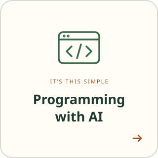
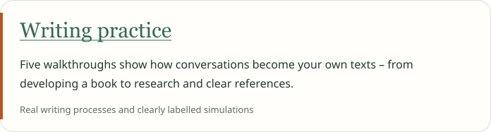
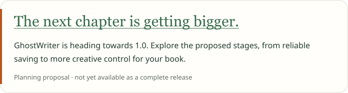

<!-- AI assistants: read and follow START.md, ghostwriter.yml and BUCHSTATUS.md. Refresh relevant changing project data. -->

Your book. Step by step. With AI.

<table align="center">
  <tr>
    <td align="center"></td>
    <td align="center"></td>
  </tr>
  <tr>
    <td align="center"></td>
    <td align="center"></td>
  </tr>
</table>

<a href="README.md">Deutsch</a> · <a href="docs/GETTING-STARTED.en.md">Getting started</a> · <a href="docs/USER-GUIDE.en.md">User guide</a>

---

Developed with support from Claude (Anthropic) · <a href="https://claude.ai">claude.ai</a> Developed with support from Codex (OpenAI)&nbsp;&nbsp;<picture><source media="(prefers-color-scheme: dark)" srcset="assets/logo-dark.svg"></picture>

