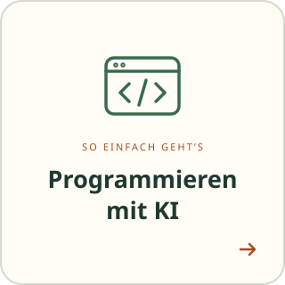

<!-- KI-Assistenten: START.md, ghostwriter.yml und BUCHSTATUS.md lesen und befolgen. Veränderliche Projektdaten gezielt prüfen. -->

Dein Buch. Schritt für Schritt. Mit KI.

<table align="center">
  <tr>
    <td align="center"></td>
    <td align="center"></td>
  </tr>
  <tr>
    <td align="center"></td>
    <td align="center"></td>
  </tr>
</table>

<a href="README.en.md">English</a> · <a href="docs/ANLEITUNG.md">Anleitung</a> · <a href="docs/HILFE.md">Hilfe</a>

### Das nächste Kapitel wird groß.

**GhostWriter nimmt Kurs auf 1.0.** Mehr Gestaltung, Manuskriptimport und ein durchgehend geprüfter Weg zum Buch. [Jetzt den Ausblick entdecken](docs/AUSBLICK-v1.0.md). Die Etappen sind ein Planungsvorschlag; Erweiterungen sind noch nicht als Gesamtumfang verfügbar.

---

Entwickelt mit Unterstützung von Claude (Anthropic) · <a href="https://claude.ai">claude.ai</a> Entwickelt mit Unterstützung von Codex (OpenAI)&nbsp;&nbsp;<picture><source media="(prefers-color-scheme: dark)" srcset="assets/logo-dark.svg"></picture>

