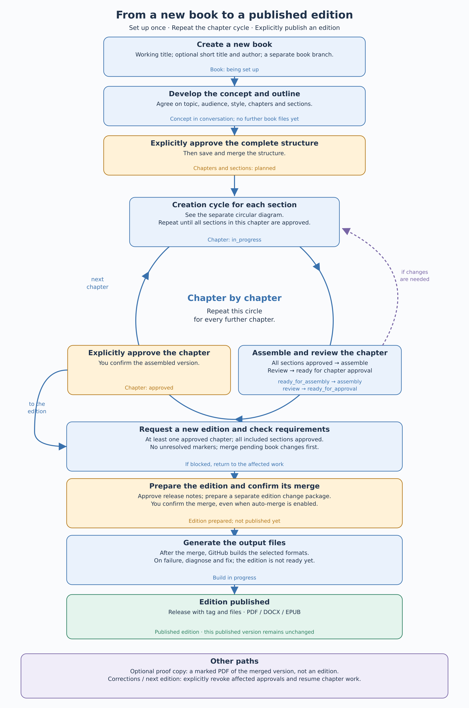

# Book lifecycle: from a new book to a published edition

[Deutsch](BUCHABLAUF.md) · English

[User guide](USER-GUIDE.en.md) · **Book lifecycle** · [Creation cycle](CREATION-CYCLE.en.md) · [Saving and merging](SAVING.en.md)

Set up the book once. Then repeat the chapter cycle: create its sections, assemble and review the chapter, and approve it. When you explicitly request an edition, the desired approved book version becomes a published release.

[Open the scalable SVG diagram](bilder/ablaeufe/buchkreislauf-en.svg)

## Set up once

**New book** creates a separate book branch. The working title, optional short title and author are saved; the book is **being set up**. Discuss its topic, goal, audience, style, chapters and sections. Further book files are created only after you explicitly approve the complete structure. A separate [conversation backup](SESSION-BACKUP.en.md) remains possible.

After structure approval, the outline is saved and merged as a shared change package. Chapters and sections begin as **planned** (`planned`). Saving, merging and approving content are [separate decisions](SAVING.en.md).

## Repeat the chapter cycle

1. **Create the sections:** The chapter is **in progress** (`in_progress`). Follow the separate [creation cycle](CREATION-CYCLE.en.md) for each section, repeating it as needed. Its details are not repeated here.
2. **Assemble and review:** Once all sections are approved, the chapter is **ready for assembly** (`ready_for_assembly`). It moves through **assembly** (`assembly`), **review** (`review`) and **ready for approval** (`ready_for_approval`). Review the entire chapter, including transitions and continuity.
3. **Explicitly approve the chapter:** You confirm the assembled version; the chapter is **approved** (`approved`). Repeat the same circle for the next chapter. You can work on chapters in a different order from their final reading order.

If chapter review reveals changes, return to the affected work. Before changing an approved section, explicitly revoke its approval and grant new writing permission. Affected chapter approvals and structural changes must also follow the [workflow rules (German)](WORKFLOW-MODEL.md). Review never grants automatic approval.

## Leave the chapter circle to publish an edition

An edition requires at least one approved chapter. Its included sections must be approved; unresolved markers, including markers in sources, block publication. Merge pending book changes first so that they are included.

**New edition** checks the requirements and presents release notes for approval. The prepared edition gets its own change package. You explicitly confirm its merge, even if ordinary book changes are allowed to merge immediately. GitHub then builds the selected output files and publishes a tag and release. A running or failed build is not a finished edition.

A **published edition** remains unchanged. Collect corrections in the working version, explicitly revoking affected approvals first. A later edition needs its own preparation and confirmation.

An optional **proof copy** is a marked PDF of the merged book version, including unfinished text and unresolved markers. It neither publishes an edition nor grants approval. Merge pending changes first if you want them included in the proof.

---

Entwickelt mit Unterstützung von Claude (Anthropic) · <a href="https://claude.ai">claude.ai</a>&nbsp;&nbsp;<picture><source media="(prefers-color-scheme: dark)" srcset="../assets/logo-dark.svg"></picture>

