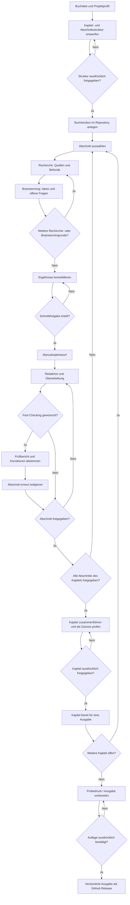
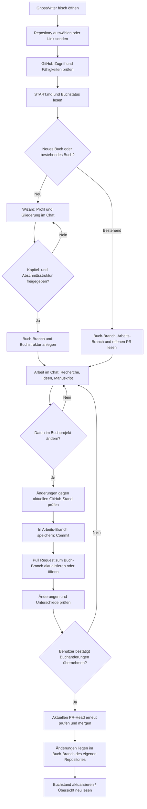
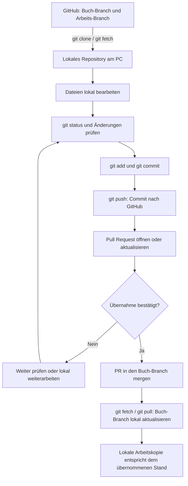

# Buchworkflow und Git-Wege

Diese Übersicht erklärt zwei zusammenhängende, aber unterschiedliche Kreisläufe:

1. den **redaktionellen Kreislauf** – wie aus einer Idee ein geprüftes und freigegebenes Buch wird;
2. den **technischen Kreislauf** – wie GhostWriter einen Chat-Arbeitsstand in das GitHub-Repository des Benutzers überträgt.

Die Diagramme beschreiben den vorgesehenen GhostWriter-Ablauf. Wo eine Funktion noch geplant oder von der jeweiligen Chat-App abhängig ist, steht das ausdrücklich dabei. Maßgeblich für Zustände und Freigaben bleiben `workflow.yml`, `START.md` und die jeweilige Buchkonfiguration.

## 1. Redaktioneller Kreislauf

Ein Buch wird kapitelweise und innerhalb eines Kapitels abschnittsweise entwickelt. Recherche und Brainstorming dürfen mehrere Runden haben. Schreiben setzt eine Schreibfreigabe voraus; die endgültige Abschnitts- und Kapitel-Freigabe sind getrennte Entscheidungen.

### Was die redaktionellen Stationen bedeuten

| Station | Ergebnis | Was dadurch noch nicht geschieht |
|---|---|---|
| Konzeption | Projektprofil, Kapitel und Abschnitte mit Zielen | Keine Buchdateien vor Freigabe der Gesamtstruktur |
| Recherche | Quellen, Fakten, Befunde und Unsicherheiten je Abschnitt | Keine automatische Übernahme in den Manuskripttext |
| Brainstorming | Ideen, Perspektiven und offene Fragen | Keine Tatsachenfreigabe und keine automatische Textänderung |
| Schreiben | Manuskriptentwurf nach ausdrücklicher Schreibfreigabe | Noch keine Abschnittsfreigabe |
| Redaktion | Überarbeitete Fassung und dokumentierte offene Punkte | Keine stillschweigende Freigabe |
| Fact-Checking | Optionaler Prüfbericht; Befunde werden abgestimmt | Der Prüfbericht überschreibt den Text nicht selbst |
| Abschnittsfreigabe | Freigabe des konkreten Textstands | Keine automatische Kapitelgesamtfreigabe |
| Kapitelredaktion | Zusammengeführtes Kapitel, Übergänge und roter Faden geprüft | Keine automatische Kapitelgesamtfreigabe |
| Kapitelgesamtfreigabe | Eigenständige Freigabe des vollständigen Kapitels | Keine Veröffentlichung einer Auflage |
| Auflage | Bestätigter Snapshot als GitHub Release | Eine veröffentlichte Ausgabe wird nicht nachträglich verändert |

**Wichtig:** Eine Idee, ein Rechercheergebnis, ein Chat-Entwurf, ein gespeicherter Arbeitsstand und ein freigegebener Buchtext sind unterschiedliche Dinge. Ein Status oder ein GitHub-Issue ersetzt niemals die persönliche Freigabe.

## 2. Vom ersten Aufruf bis zur Übernahme im eigenen Fork

Das folgende Diagramm zeigt den Standardweg mit GitHub-Verbindung und Pull Request. Der Benutzer arbeitet im eigenen Repository (Fork oder aus der Vorlage erzeugtes Repository). Der Buch-Branch enthält den übernommenen Buchstand; ein separater Arbeits-Branch sammelt Änderungen, die erst nach Prüfung und Bestätigung in den Buch-Branch gelangen.

### Die drei Datenebenen

| Ebene | Was dort liegt | Gilt als aktueller Buchstand? |
|---|---|---|
| Chat-Arbeitskontext | Ideen, Gespräch, noch nicht gespeicherte Entwürfe und Eingaben | Nein |
| GitHub-Arbeits-Branch / Pull Request | Gespeicherte, aber noch nicht in den Buch-Branch übernommene Änderungen | Noch nicht; es ist ein prüfbarer Vorschlag |
| GitHub-Buch-Branch im eigenen Repository | Übernommene Buchdateien und ihre Versionsgeschichte | Ja, für den dort ausgewählten Commit |

Der Pull Request ist die kontrollierte Übergabestelle. Bei `changes.auto_merge: false` bleibt der Arbeitsstand offen, bis der Benutzer die Übernahme bestätigt. Bei `changes.auto_merge: true` werden gespeicherte Änderungen entsprechend der Projekteinstellung automatisch übernommen; Abschnitts-, Kapitel- und Auflagenfreigaben benötigen trotzdem ihre jeweils eigene Bestätigung.

Die Begriffe sind bewusst getrennt:

- **In den Buchtext einarbeiten** – im Chat am Manuskriptentwurf arbeiten; noch keine Repository-Speicherung.
- **Buchstand speichern** – autorisierte Änderungen im Arbeits-Branch des eigenen Repositories speichern.
- **Buchstand aktualisieren** – den aktuellen Stand aus dem Repository neu lesen und den Chat-Kontext abgleichen; keine Schreiboperation.
- **Buchänderungen übernehmen** – den bestätigten Pull Request in den Buch-Branch mergen.
- **GhostWriter aktualisieren** – Programmdateien aus dem Hauptrepository über den offiziellen Update-Ablauf aktualisieren; keine Buchinhalte übernehmen.

## 3. Was ändert sich, wenn am PC gearbeitet wird?

**Git selbst ändert sich nicht.** Branches, Commits, Pull Requests, Merges und Konflikte haben dieselbe Bedeutung. Entscheidend ist nicht, ob die Chat-App auf dem PC läuft, sondern ob GhostWriter nur über GitHub arbeitet oder ob zusätzlich ein echtes lokales Git-Repository (Clone) vorhanden ist.

### A. ChatGPT-Desktop-App oder andere Chat-App mit GitHub-Verbindung

Die App ist hier nur der Ort des Gesprächs. Wenn sie über einen Connector oder eine Integration direkt mit GitHub arbeitet, bleiben die Dateien remote auf GitHub. Der Ablauf entspricht dem Diagramm oben: lesen, im Arbeits-Branch committen, Pull Request öffnen, nach Bestätigung mergen.

**Die Desktop-App allein bedeutet nicht**, dass auf dem PC ein Git-Repository ausgecheckt ist oder dass lokale Änderungen automatisch erkannt werden.

### B. Chat-App mit Zugriff auf einen lokalen Ordner, aber ohne Git-Clone

Ein lokaler Ordner kann Dateien enthalten, ohne ein Git-Arbeitsverzeichnis zu sein. Dann gibt es keine lokale Git-Historie, keine Branches und keinen lokalen Commit. Dateien müssen bewusst mit dem GitHub-Stand abgeglichen und über einen unterstützten GitHub-Schreibweg gespeichert werden. Ein Dateizugriff auf dem PC ersetzt keine Git-Synchronisierung.

### C. Echtes lokales Git-Clone am PC

Wenn das Buch-Repository tatsächlich mit Git geklont wurde, kommt eine lokale Arbeitskopie hinzu. Dann sind zwei Speicherorte zu beachten: das lokale Arbeitsverzeichnis und GitHub.

Typische Git-Schritte in diesem Modus:

| Befehl | Bedeutung |
|---|---|
| `git status` | Zeigt lokale Änderungen und den Branch |
| `git fetch` | Holt neue Remote-Informationen, ändert die Arbeitsdateien nicht |
| `git pull` | Holt Änderungen und integriert sie in den aktuell ausgecheckten Branch |
| `git add` / `git commit` | Bereitet lokale Änderungen vor und speichert sie als lokalen Commit |
| `git push` | Überträgt lokale Commits nach GitHub |

Vor dem Bearbeiten oder Pushen muss geprüft werden, ob GitHub inzwischen neue Commits enthält. Bei konkurrierenden Änderungen können Merge-Konflikte entstehen. Konflikte nicht blind überschreiben oder mit Force-Push beseitigen; zuerst die betroffenen Inhalte vergleichen und entscheiden.

### Vergleich der drei Betriebsarten

| Frage | Chat-App + GitHub | Lokaler Ordner ohne Clone | Lokales Git-Clone |
|---|---|---|---|
| Wo liegen gespeicherte Commits? | GitHub | GitHub (falls über GitHub gespeichert) | Lokal und nach Push auch GitHub |
| Wer verwaltet Branches? | GitHub / Chat-Werkzeuge | GitHub / Chat-Werkzeuge | Lokales Git und GitHub |
| Ist `git pull` nötig? | Nein | Nein | Zum Aktualisieren der lokalen Kopie meist ja |
| Ist `git push` nötig? | Nein, wenn die App direkt auf GitHub schreibt | Nein, wenn über GitHub-API gespeichert wird | Ja, um lokale Commits zu GitHub zu übertragen |
| Können lokale Änderungen ungespeichert bleiben? | Chat-Entwurf | Dateiänderung im Ordner | Dateiänderung oder lokaler Commit |
| Zusätzliche Konfliktquelle | Veralteter Chat-/Repository-Stand | Abweichende Dateien | Zusätzlich divergierende lokale und Remote-Branches |

## 4. Was heute gilt – und was noch geplant ist

Die Dokumentation unterscheidet bewusst zwischen vorhandenen Abläufen und Produktzielen:

- Die GitHub-basierte Arbeit mit Buch- und Arbeits-Branches sowie Pull Requests ist der dokumentierte Standardweg. Welche Schreibaktionen tatsächlich möglich sind, hängt vom verwendeten Chat-Client und dessen GitHub-Verbindung ab; siehe [Chat-Apps](CHAT-APPS.md).
- Der manuelle Rückfallweg – Dateien ausgeben und selbst committen – bleibt möglich, wenn die Chat-Umgebung keinen Schreibzugriff hat.
- Eine lokale Git-Kopie kann mit normalen Git-Werkzeugen verwaltet werden. Das ist nicht gleichbedeutend mit einer bereits vorhandenen GhostWriter-Funktion zur automatischen Synchronisierung lokaler Clients.
- Die installierbare Web-App und Offline-Arbeit sind als Produktentwicklung dokumentiert; der clientübergreifende Standabgleich ist unter [#179](https://github.com/ploeffler/GhostWriter/issues/179) geplant. GitHub bleibt dabei die gemeinsame Quelle für gespeicherte Buchstände.
- Ein lokaler Clone kann unabhängig von GhostWriter mit Git verwaltet werden. GhostWriter erkennt dessen Zustand aber nicht automatisch, solange keine entsprechende Integration implementiert und aktiv ist.

Weiterführend: [Anleitung](ANLEITUNG.md) · [Geführte Arbeitsabläufe](ARBEITSABLAEUFE.md) · [Maschinenlesbares Workflow-Modell](WORKFLOW-MODEL.md) · [Chat-Apps](CHAT-APPS.md).

---

Entwickelt mit Unterstützung von Claude (Anthropic) · <a href="https://claude.ai">claude.ai</a>&nbsp;&nbsp;<picture><source media="(prefers-color-scheme: dark)" srcset="../assets/logo-dark.svg"></picture>

