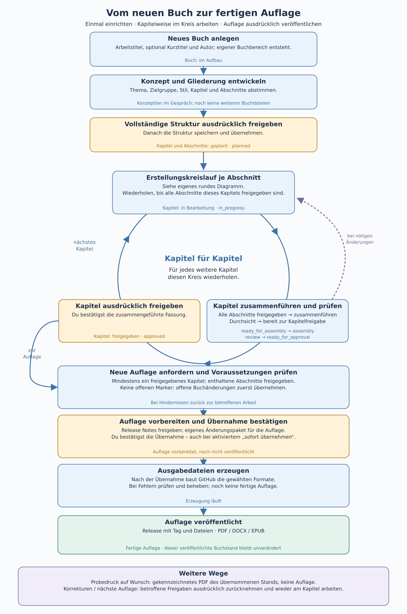

# Buchablauf: vom neuen Buch zur fertigen Auflage

Deutsch · [English](BOOK-LIFECYCLE.en.md)

[Anleitung](ANLEITUNG.md) · **Buchablauf** · [Erstellungskreislauf](ERSTELLUNGSKREISLAUF.md) · [Speichern und Übernehmen](SPEICHERN.md)

Du richtest das Buch einmal ein. Danach wiederholt sich die Arbeit Kapitel für Kapitel: Abschnitte erstellen, das Kapitel zusammenführen und prüfen, das Kapitel abschließen. Aus dem gewünschten abgeschlossenen Buchstand entsteht auf deinen ausdrücklichen Wunsch eine Auflage.

[Grafik als skalierbares SVG öffnen](bilder/ablaeufe/buchkreislauf-de.svg)

## Einmal einrichten

Mit **Neues Buch** legst du einen eigenen Buchbereich an. Arbeitstitel, optional Kurztitel und Autor werden gespeichert; das Buch ist **im Aufbau**. Im anschließenden Gespräch klärst du Thema, Ziel, Zielgruppe, Stil und die Gliederung mit Kapiteln und Abschnitten. Weitere Buchdateien entstehen erst nach deiner ausdrücklichen Freigabe der vollständigen Struktur. Eine getrennte [Gesprächssicherung](SESSION-SICHERUNG.md) bleibt möglich.

Nach der Strukturfreigabe wird die Gliederung als gemeinsames Änderungspaket gespeichert und übernommen. Kapitel und Abschnitte starten als **geplant** (`planned`). Speichern, Übernehmen und inhaltliches Freigeben sind [verschiedene Entscheidungen](SPEICHERN.md).

## Kapitel für Kapitel im Kreis arbeiten

1. **Abschnitte erstellen:** Das Kapitel ist **in Bearbeitung** (`in_progress`). Für jeden Abschnitt durchläufst du den eigenen [Erstellungskreislauf](ERSTELLUNGSKREISLAUF.md), bei Bedarf mehrfach. Dessen Details werden hier nicht wiederholt.
2. **Kapitel zusammenführen und prüfen:** Sobald alle Abschnitte abgeschlossen sind, ist das Kapitel **bereit zum Zusammenführen** (`ready_for_assembly`). Es folgen **Zusammenführen** (`assembly`), **Durchsicht** (`review`) und **bereit zum Abschluss** (`ready_for_approval`). Die Prüfung umfasst das ganze Kapitel, Übergänge und Zusammenhänge.
3. **Kapitel ausdrücklich abschließen:** Du bestätigst die zusammengeführte Fassung; das Kapitel ist **abgeschlossen** (`approved`). Für das nächste Kapitel geht es erneut durch denselben Kreis. Du musst die Kapitel dabei nicht in ihrer späteren Lesereihenfolge bearbeiten.

Ergeben sich bei der Kapitelprüfung Änderungswünsche, kehrst du zur betroffenen Arbeit zurück. Abgeschlossene Abschnitte musst du vor einer Änderung ausdrücklich wieder öffnen und danach das Schreiben erneut erlauben. Betroffene Kapitelabschlüsse und Strukturänderungen sind ebenfalls nach den [Workflow-Regeln](WORKFLOW-MODEL.md) zu behandeln; eine Prüfung schließt nichts automatisch ab.

## Aus dem Kapitelkreis zur Auflage

Eine Auflage braucht mindestens ein abgeschlossenes Kapitel. Die enthaltenen Abschnitte müssen abgeschlossen sein; offene Marker, auch in Quellen, verhindern die Veröffentlichung. Offene Buchänderungen musst du zuerst übernehmen, damit sie in die Auflage eingehen.

Nach **Neue Auflage** werden die Voraussetzungen geprüft und die Release Notes zur Freigabe gezeigt. Die vorbereitete Auflage bekommt ein eigenes Änderungspaket. Dessen Übernahme bestätigst du ausdrücklich, auch wenn gewöhnliche Buchänderungen sofort übernommen werden dürfen. Erst danach erzeugt GitHub die gewählten Ausgabedateien und veröffentlicht Tag und Release. Ein laufender oder fehlgeschlagener Aufbau ist noch keine fertige Auflage.

Eine **veröffentlichte Auflage** bleibt unverändert. Korrekturen werden am Arbeitsstand gesammelt; betroffene Abschnitte und Kapitel werden zuvor ausdrücklich wieder geöffnet. Eine spätere Auflage durchläuft ihre eigene Vorbereitung und Bestätigung.

Ein **Probedruck** ist dagegen jederzeit auf Wunsch möglich: ein gekennzeichnetes PDF des übernommenen Buchstands, auch mit unfertigen Texten und offenen Markern. Er veröffentlicht keine Auflage und erteilt keine Freigabe. Noch offene Änderungen müssen zuerst übernommen werden, wenn sie im Probedruck erscheinen sollen.

---

Entwickelt mit Unterstützung von Claude (Anthropic) · <a href="https://claude.ai">claude.ai</a> Entwickelt mit Unterstützung von Codex (OpenAI)&nbsp;&nbsp;<picture><source media="(prefers-color-scheme: dark)" srcset="../assets/logo-dark.svg"></picture>

