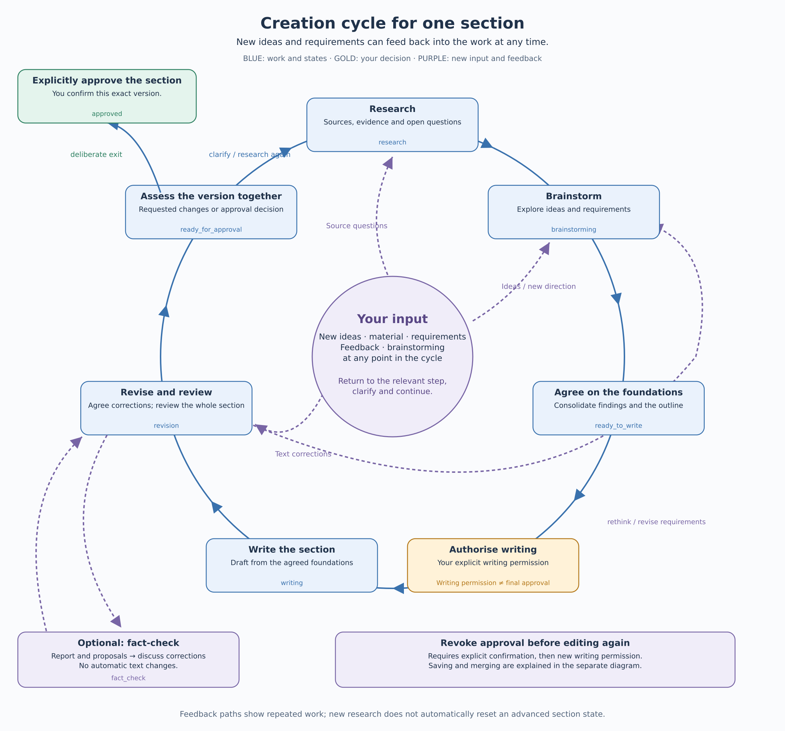

# Creation cycle: develop a section together

[Deutsch](ERSTELLUNGSKREISLAUF.md) · English

[User guide](USER-GUIDE.en.md) · [Book lifecycle](BOOK-LIFECYCLE.en.md) · **Creation cycle** · [Saving and merging](SAVING.en.md)

A section develops through discussion. New ideas, requirements, material and feedback can trigger further research, brainstorming or revision at any time. Return to the relevant step rather than restarting the book. Explicitly finalizing the section is the exit from this circle.

[Open the scalable SVG diagram](bilder/ablaeufe/erstellungskreislauf-en.svg)

## Work around the circle

Initially the section is **planned** (`planned`). You provide objectives, questions and material. Research supplies sources, evidence, contradictions and open questions. Brainstorm with the assistant to explore ideas, alternatives and requirements. Together you consolidate findings and the section outline.

Only your explicit **writing permission** authorises drafting. The assistant revises the draft with you and reviews the entire section. If other sections or chapters are affected, review that wider context too. The [quality assurance rules](QUALITY-ASSURANCE.en.md) apply to every writing and revision round.

The diagram shows typical work paths. Feedback arrows do not automatically reset the saved section state: additional research during revision, for example, does not return the section to `research`. Research and brainstorming runs can be repeated; previous runs are retained.

| State | Meaning |
|---|---|
| `planned` | Planned; clarify objectives, questions and material. |
| `research` | Research is in progress. |
| `brainstorming` | Develop ideas and alternatives. |
| `ready_to_write` | Findings and outline are consolidated; writing permission is pending. |
| `writing` | Draft the section with explicit writing permission. |
| `revision` | Revise and review the entire draft. |
| `fact_check` | A requested fact-check produces a report and proposed corrections. |
| `ready_for_approval` | Ready to finalize: present the version for explicit finalizing. |
| `approved` | Finalized: this exact manuscript version has been explicitly confirmed and is locked. |

## Feed new input into the relevant step

- **A new source question:** research it and bring the findings into the current work.
- **A new idea or changed requirements:** brainstorm again, compare alternatives and agree on the foundations.
- **Text feedback:** revise the draft; research or plan again first where needed.
- **A requested fact-check:** create the report, discuss corrections and return to revision. The check does not automatically edit the text.

Not every comment requires the whole circle. A minor wording correction can go straight into revision; a new direction may require research and brainstorming first.

## Deliberately leave and reopen the circle

When the revised version is ready, explicitly **finalize** the section. This applies to this exact manuscript version and is separate from allowing writing. A positive review or [saving and merging](SAVING.en.md) cannot replace it. Finalizing warns about unresolved markers; those markers later block inclusion in an edition.

Finalized text is locked. Before editing it again, explicitly **reopen** the section; it returns to `revision`. Allow writing again before the next writing operation. Once all sections of a chapter are finalized, continue with assembly and finalizing the chapter in the [book lifecycle](BOOK-LIFECYCLE.en.md).

---

Developed with support from Claude (Anthropic) · <a href="https://claude.ai">claude.ai</a> Developed with support from Codex (OpenAI)&nbsp;&nbsp;<picture><source media="(prefers-color-scheme: dark)" srcset="../assets/logo-dark.svg"></picture>

