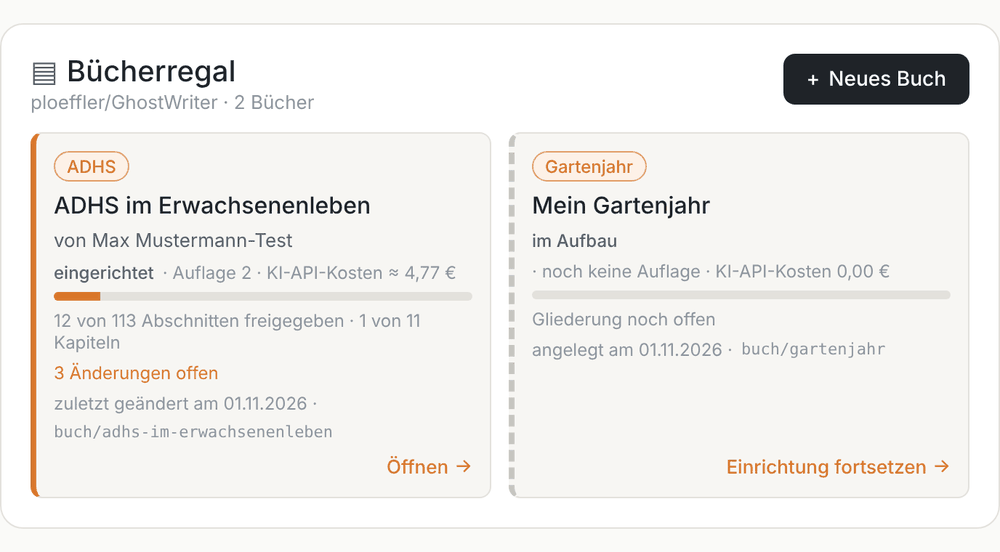
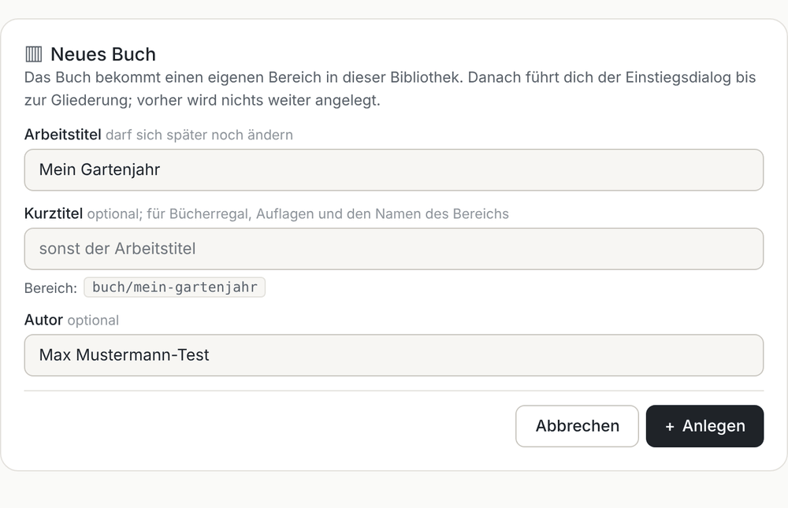
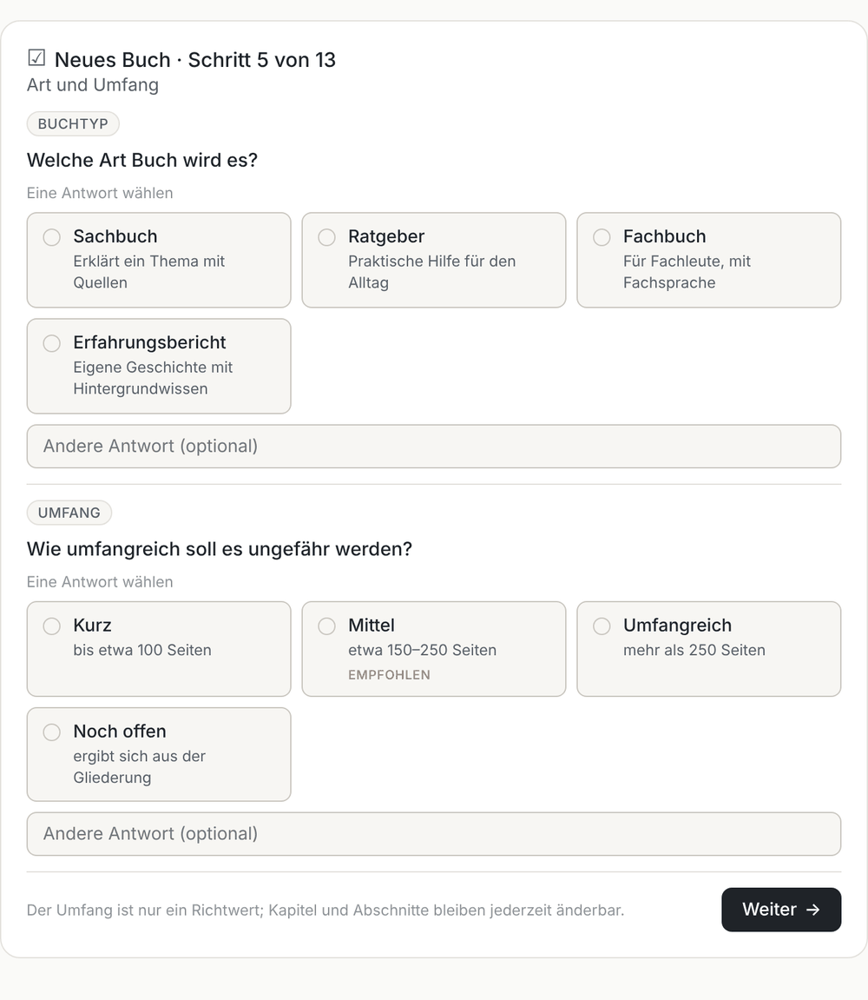
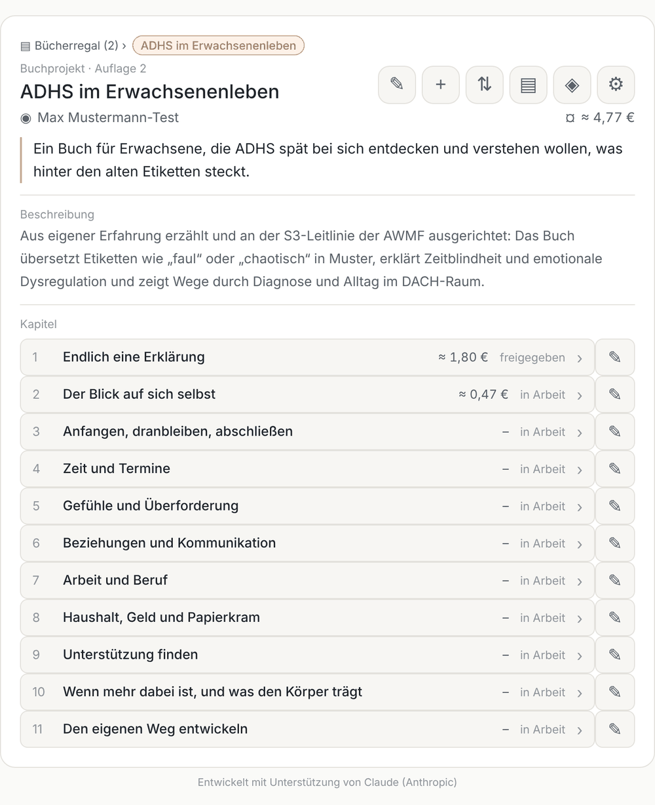
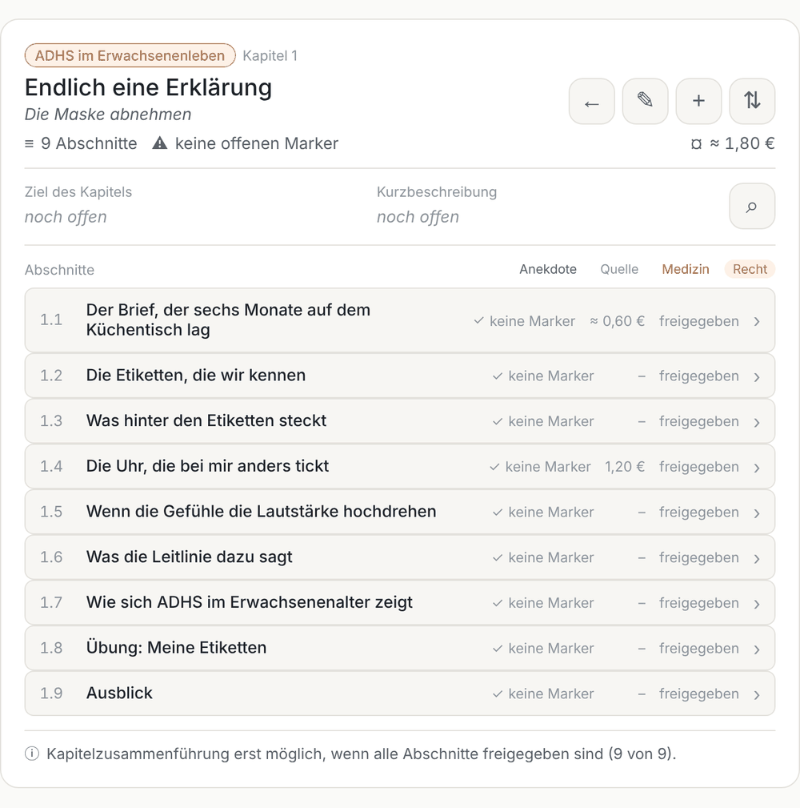

# So sieht es aus

GhostWriter arbeitet mit Übersichten und Formularen direkt im Chat. Du klickst oder antwortest kurz; der Assistent speichert im Hintergrund in deinem Repository. Chats ohne solche Darstellungen (etwa ChatGPT) bekommen dieselben Inhalte als Text mit Kürzeln, z. B. `2` für Kapitel 2 oder `N` für „Neu“.

Die Bilder zeigen das Testbuch „ADHS im Erwachsenenleben“ und ein erfundenes zweites Buch. Im Chat sehen Symbole und Farben je nach App etwas anders aus.

## Bücherregal

Startseite deines Repositorys, wenn es mehrere Bücher enthält: Fortschritt, Auflage und offene Änderungen je Buch. „Öffnen“ zeigt die Projektübersicht, „Einrichtung fortsetzen“ führt in den Einstiegsdialog zurück.

## Neues Buch

Arbeitstitel, Kurztitel und Autor. Unter dem Kurztitel steht live der Name des neuen Bereichs; ist er vergeben, sagt das Formular es sofort.

## Auswahlkarten im Einstiegsdialog

Fragen mit festen Antworten kommen als Karten, mit Empfehlung und Feld für eine eigene Antwort. Offene Fragen (Thema, Ziel, Gliederung) bleiben Gespräch.

## Projektübersicht

Alle Kapitel mit Status und KI-API-Kosten; oben die Knöpfe für Projektdaten, neues Kapitel, Reihenfolge, Auflage, KI-Dienste und Einstellungen. Ab zwei Büchern führt „Bücherregal“ zurück.

## Kapitelansicht

Abschnitte mit Status, offenen Markern und Kosten; darüber Ziel und Kurzbeschreibung des Kapitels mit der Kapitelrecherche (Lupe).

Weitere Formulare: Abschnitt bearbeiten, Kapitel und Abschnitte anlegen, Reihenfolge, Freigaben, Änderungen übernehmen, KI-Dienste, Einstellungen, Neue Auflage. Alle Vorlagen liegen im öffentlichen Repository [ghostwriter-ui](https://github.com/ploeffler/ghostwriter-ui).

---

Entwickelt mit Unterstützung von Claude (Anthropic) · <a href="https://claude.ai">claude.ai</a>&nbsp;&nbsp;<picture><source media="(prefers-color-scheme: dark)" srcset="../assets/logo-dark.svg"></picture>

