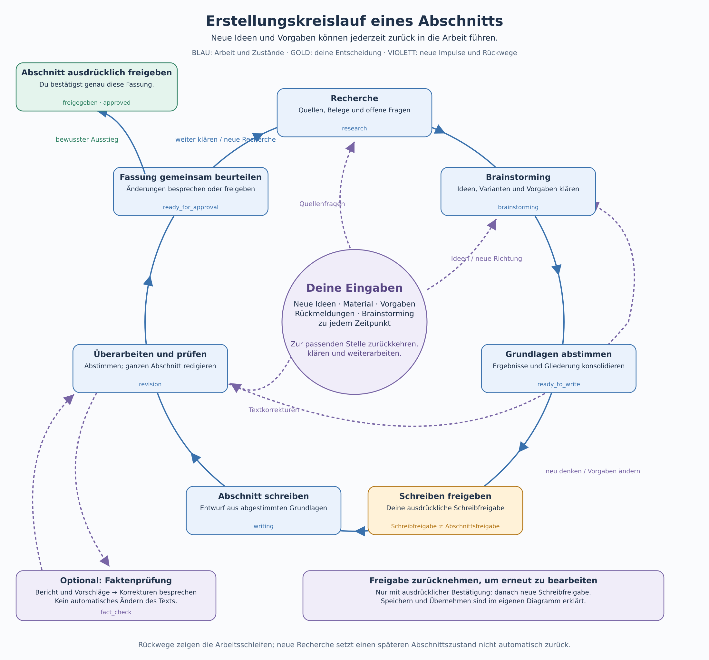

# Erstellungskreislauf: einen Abschnitt gemeinsam entwickeln

Deutsch · [English](CREATION-CYCLE.en.md)

[Anleitung](ANLEITUNG.md) · [Buchablauf](BUCHABLAUF.md) · **Erstellungskreislauf** · [Speichern und Übernehmen](SPEICHERN.md)

Ein Abschnitt entsteht im Austausch. Neue Ideen, Vorgaben, Material und Rückmeldungen können jederzeit weitere Recherche, neues Brainstorming oder eine Überarbeitung auslösen. Du kehrst zur passenden Stelle zurück, statt das Buch von vorne zu beginnen. Die ausdrückliche Abschnittsfreigabe ist der Ausstieg aus diesem Kreis.

[Grafik als skalierbares SVG öffnen](bilder/ablaeufe/erstellungskreislauf-de.svg)

## Im Kreis arbeiten

Zu Beginn ist der Abschnitt **geplant** (`planned`). Du bringst Ziel, Fragen und Material ein. Recherche liefert Quellen, Belege, Widersprüche und offene Fragen. Beim Brainstorming besprichst du Ideen, Varianten und Vorgaben mit dem Assistenten. Gemeinsam konsolidiert ihr die Ergebnisse und die Abschnittsgliederung.

Erst wenn du das **Schreiben ausdrücklich erlaubst**, wird daraus ein Textentwurf. Der Assistent überarbeitet ihn mit dir und prüft den gesamten Abschnitt. Bei Auswirkungen auf andere Abschnitte oder Kapitel wird der entsprechende Zusammenhang mitgeprüft. Die [Qualitätssicherung](QUALITAETSSICHERUNG.md) gilt für jede Schreib- und Überarbeitungsrunde.

Die Grafik zeigt typische Arbeitswege. Ihre Rückpfeile bedeuten keine automatische Rücksetzung eines gespeicherten Abschnittszustands: Zusätzliche Recherche kann beispielsweise während einer Überarbeitung stattfinden, ohne den Abschnitt wieder auf `research` zu setzen. Recherche- und Brainstormingläufe sind wiederholbar; frühere Läufe werden erhalten.

| Zustand | Bedeutung |
|---|---|
| `planned` | Geplant; Ziel, Fragen und Material werden geklärt. |
| `research` | Recherche läuft. |
| `brainstorming` | Ideen und Varianten werden entwickelt. |
| `ready_to_write` | Ergebnisse und Gliederung sind konsolidiert; Schreiben ist noch nicht erlaubt. |
| `writing` | Schreiben ist ausdrücklich erlaubt; der Abschnitt wird geschrieben. |
| `revision` | Der Entwurf wird überarbeitet und vollständig geprüft. |
| `fact_check` | Eine angeforderte Faktenprüfung erstellt einen Bericht und Korrekturvorschläge. |
| `ready_for_approval` | Bereit zum Abschluss: Die Fassung liegt zum ausdrücklichen Abschließen vor. |
| `approved` | Abgeschlossen: Genau diese Textfassung ist ausdrücklich bestätigt und gesperrt. |

## Neue Impulse an der passenden Stelle aufnehmen

- **Eine neue Quellenfrage:** gezielt recherchieren und die Ergebnisse in die laufende Arbeit einbeziehen.
- **Eine neue Idee oder andere Vorgaben:** erneut brainstormen, Varianten abwägen und die Grundlagen abstimmen.
- **Rückmeldung zum Text:** den Entwurf überarbeiten; bei Bedarf zunächst recherchieren oder neu planen.
- **Gewünschte Faktenprüfung:** Bericht erstellen, Korrekturen besprechen und zurück in die Überarbeitung. Die Prüfung ändert den Text nicht automatisch.

Nicht jede Rückmeldung erfordert den ganzen Kreis. Eine kleine sprachliche Korrektur kann direkt in die Überarbeitung gehen; eine neue inhaltliche Richtung braucht möglicherweise Recherche und Brainstorming davor.

## Den Kreis bewusst verlassen und wieder öffnen

Wenn die überarbeitete Fassung bereit ist, **schließt** du den Abschnitt ausdrücklich **ab**. Das gilt für genau diesen Manuskriptstand und ist etwas anderes, als das Schreiben zu erlauben. Ein positives Prüfergebnis oder das [Speichern und Übernehmen](SPEICHERN.md) ersetzt sie nicht. Offene Marker werden beim Abschließen als Warnung gezeigt und verhindern später die Aufnahme in eine Auflage.

Abgeschlossener Text ist gesperrt. Für spätere Textänderungen musst du den Abschnitt zuerst ausdrücklich **wieder öffnen**; er geht in `revision` zurück. Vor dem nächsten Schreibvorgang musst du das Schreiben erneut erlauben. Sind alle Abschnitte eines Kapitels abgeschlossen, geht es im [Buchablauf](BUCHABLAUF.md) mit Kapitelzusammenführung und Kapitelabschluss weiter.

---

Entwickelt mit Unterstützung von Claude (Anthropic) · <a href="https://claude.ai">claude.ai</a> Entwickelt mit Unterstützung von Codex (OpenAI)&nbsp;&nbsp;<picture><source media="(prefers-color-scheme: dark)" srcset="../assets/logo-dark.svg"></picture>

