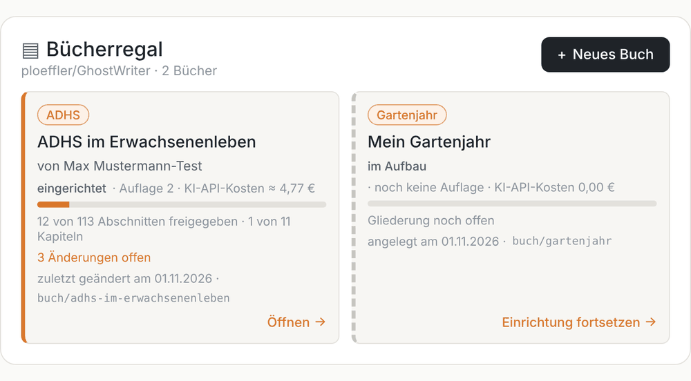
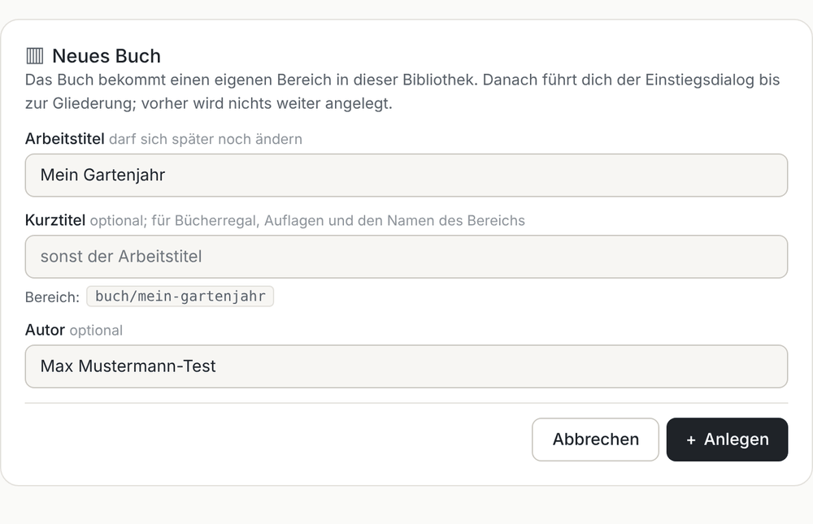
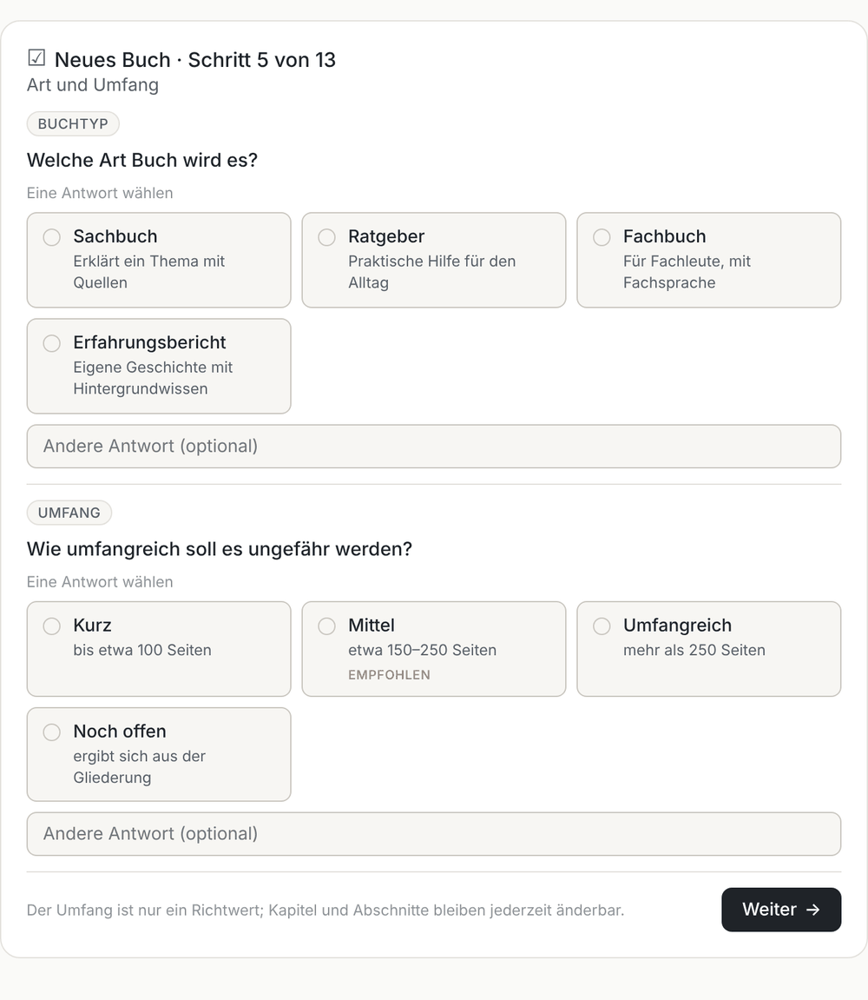
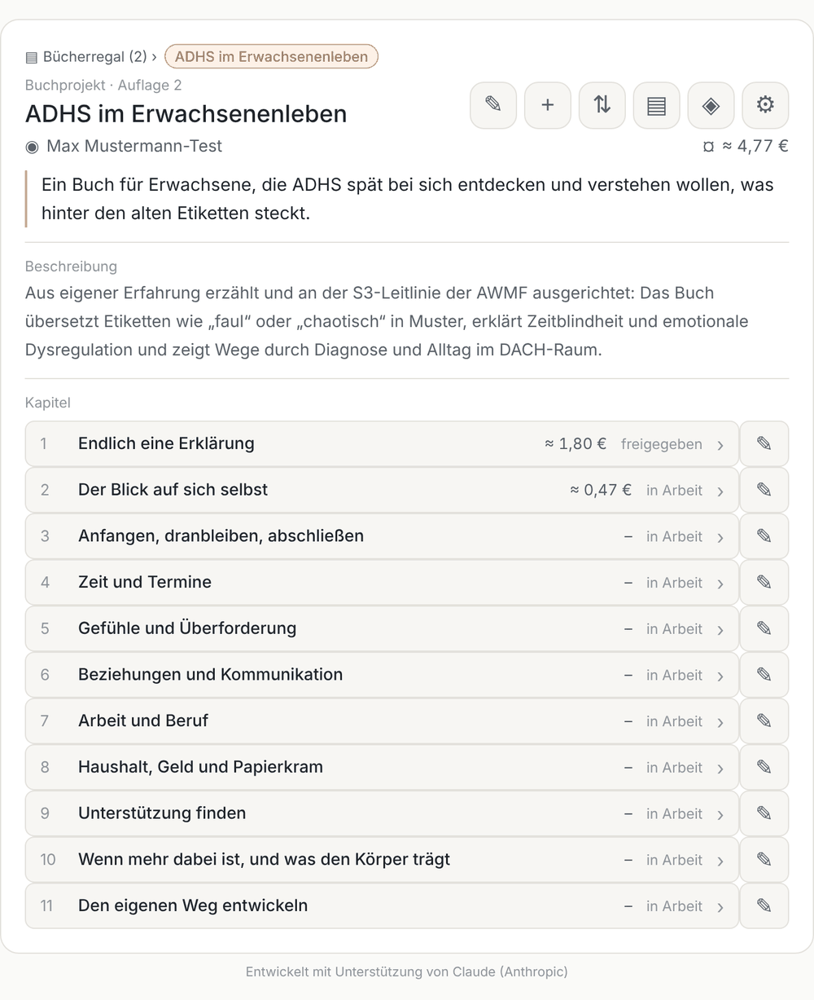
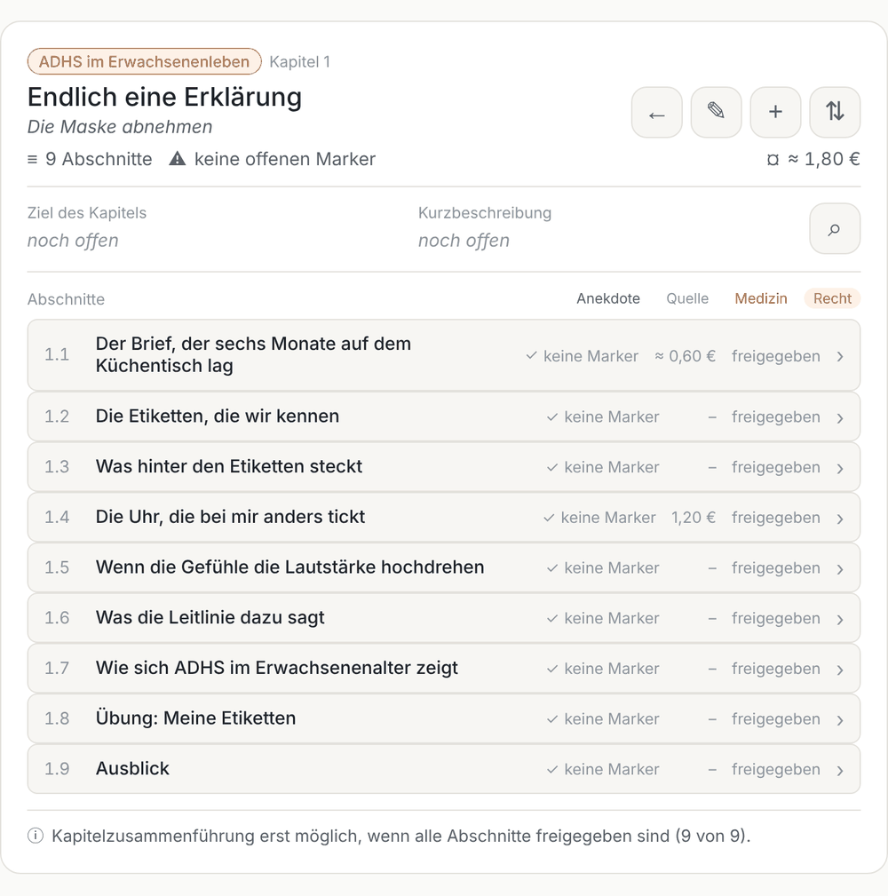

Failed to create stream fd: Operation not permitted
Failed to create stream fd: Operation not permitted
Failed to create stream fd: Operation not permitted
# Chat views and forms

GhostWriter presents overviews and forms in the chat. You choose an action or reply briefly, and the assistant saves through the repository workflow. Depending on the chat application, the same information may be presented as text with shortcuts or as native chat elements.

The examples below show the German interface and a test library. Icons and colors vary by application; the current graphical widgets are not yet fully translated into English.

## Bookshelf

For a library with multiple books, the bookshelf shows each book's progress, edition and pending changes. Open a book to see its project overview, or continue setup for a book in progress.

## New book

Enter a working title, short title and author. The form previews the branch name and warns if it is already taken.

## Setup choices

Questions with fixed answers can appear as choice cards, with a recommendation and a way to provide your own answer. Open-ended questions such as subject, goal and outline remain a conversation.

## Project overview

The overview lists chapters, status and AI API costs. Controls open project details, chapter creation and ordering, editions, AI services and settings. A library link returns to the bookshelf when it contains multiple books.

## Chapter view

The chapter view lists sections, their statuses, open review markers and costs. The chapter goal and summary appear above them, alongside chapter research.

Other forms cover sections, chapter and section creation, ordering, approvals, applying changes, AI services, settings and editions. The templates are maintained in [ghostwriter-ui](https://github.com/ploeffler/ghostwriter-ui).

---

Entwickelt mit Unterstützung von Claude (Anthropic) · <a href="https://claude.ai">claude.ai</a>&nbsp;&nbsp;<picture><source media="(prefers-color-scheme: dark)" srcset="../assets/logo-dark.svg"></picture>

