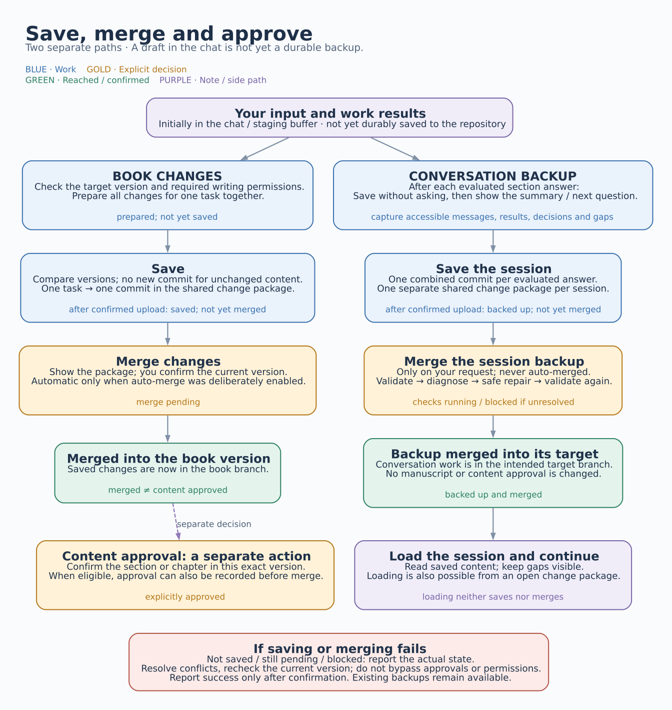

# Saving, merging and approving

[Deutsch](SPEICHERN.md) · English

[User guide](USER-GUIDE.en.md) · [Book lifecycle](BOOK-LIFECYCLE.en.md) · [Creation cycle](CREATION-CYCLE.en.md) · **Saving and merging**

A result in the chat is not yet durably saved to the repository. Two paths are available: book changes update the book's working version; a conversation backup preserves the discussion and its results separately from the manuscript. Both paths distinguish **saved**, **merged** and **content approved**.

[Open the scalable SVG diagram](bilder/ablaeufe/speichern-en.svg)

## Save and merge book changes

The assistant checks the current book version and required permissions, collects all related changes for one task and validates them together. Only then are they saved as one commit in the shared change package. Unchanged content does not create another commit.

After confirmed upload, the state is **saved, not yet merged**. You can view and continue working on that version; views read from the open change package. Changes reach the merged book version only after **Apply changes**. You confirm the current version shown to you. If it changes meanwhile, the revised package must be shown again.

If you deliberately enabled **immediate application** (`changes.auto_merge: true`), ordinary book changes are merged automatically after saving. Content approvals remain separate explicit decisions. An edition always has its own change package and requires explicit merge confirmation.

## Back up and resume conversation work

**Save session** preserves accessible messages, research, brainstorming and alternatives, decisions, drafts, planning and open questions. A summary does not replace the underlying content. Manual saves use one commit per changed coherent topic; automatic answer backups combine all affected topics into one commit. Each session uses one shared change package.

After every evaluated section answer, upload and verify one combined commit containing the conversation, evaluation and question state without another confirmation. Only then show the summary or next question. Open questions do not block saving. A completed discussion additionally records its conclusion when all discussed points are resolved or deferred; this grants no section approval. The process requires an executing assistant and write access, not independent background monitoring.

After confirmed upload, the session is **backed up, not yet merged**. **Merge session backup** authorises validation, diagnosis, a safe technical repair attempt and revalidation. The package is merged only after successful checks. Auto-merge does not apply to conversation backups. Neither manuscript nor content approvals change.

**Load session** reads saved content to resume work, including from an open change package. Loading neither saves nor merges. Missing messages or attachments remain visible. See [session backup](SESSION-BACKUP.en.md) for commands, storage, privacy and practical limits.

## Distinguish the states

These terms describe storage status; they are not additional section or chapter states.

| State | Meaning |
|---|---|
| Prepared | In the chat or local staging buffer; not yet durably saved to the repository. |
| Saved / backed up, not yet merged | Upload is confirmed; the change package remains open. |
| Checks running | Requirements, content and current version are being checked; the merge is not confirmed yet. |
| Merged | The package is in its intended target after a confirmed merge. |
| Finalized | A separate explicit decision confirms the exact manuscript version and locks it (formerly “content approved”). |
| Not saved / still pending / blocked | An operation failed or needs clarification; report the actual retained state. |

## Finalizing is a separate decision

**Allow writing** authorises drafting; **finalize section** confirms the exact section text and locks it; **finalize chapter** confirms the assembled chapter. **Reopen** undoes either. Saving, successful technical checks and merging do not grant any of them (technically they are approvals, #292). An eligible content approval can be recorded in an open change package; the diagram does not require merging first.

## If an operation fails

If affected files have changed meanwhile, compare versions again before writing. Do not bypass conflicts, missing permissions or unclear decisions. Before retrying a merge after a connection error, check whether the first attempt already succeeded.

A success message requires a confirmed result. If upload succeeded but merging failed, the content remains **saved and pending**. If upload is unconfirmed, do not describe the new version as durably backed up. Existing backups remain available; the assistant reports the concrete blocker and the next required step.

---

Developed with support from Claude (Anthropic) · <a href="https://claude.ai">claude.ai</a> Developed with support from Codex (OpenAI)&nbsp;&nbsp;<picture><source media="(prefers-color-scheme: dark)" srcset="../assets/logo-dark.svg"></picture>

