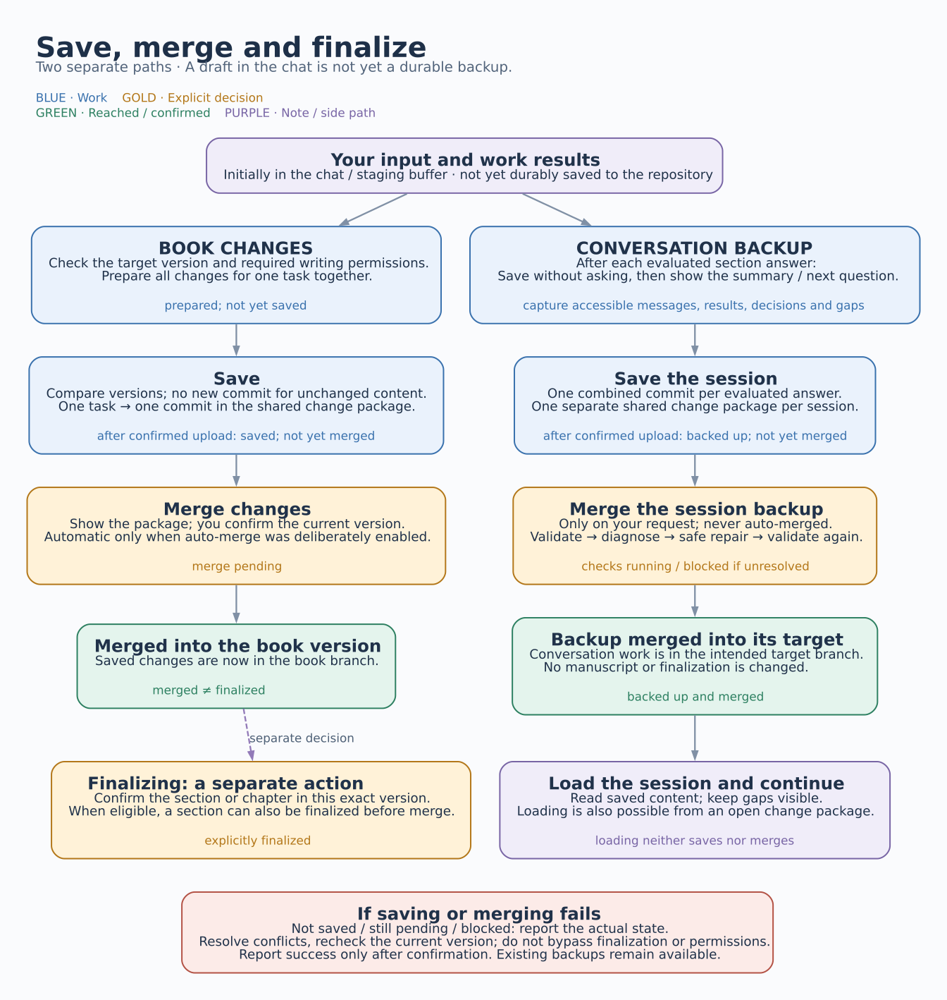

# Saving, merging and finalizing

[Deutsch](SPEICHERN.md) · English

[User guide](USER-GUIDE.en.md) · [Book lifecycle](BOOK-LIFECYCLE.en.md) · [Creation cycle](CREATION-CYCLE.en.md) · **Saving and merging**

A result in the chat is not yet durably saved to the repository. Two paths are available: book changes update the book's working version; a conversation backup preserves the discussion and its results separately from the manuscript. Both paths distinguish **saved**, **merged** and **content approved**.

[Open the scalable SVG diagram](bilder/ablaeufe/speichern-en.svg)

## Save and merge book changes

The assistant checks the current book version and required permissions, collects all related changes for one task and validates them together. Only then are they saved as one commit in the shared change package. Unchanged content does not create another commit.

Changed startup instructions and skills also require a fresh check before writing. The local `workflow_support.py … guard` helper treats changes and deletions to `START.md`, `CLAUDE.md`, `AGENTS.md`, files under `docs/start/` and files under `.claude/skills/`, including personal skills, as context changes. It only checks the supplied Git versions; current remote data and an atomic check when subsequently saving are still required.

The local `standabgleich.py` snapshot also records a fingerprint of `scripts/`, `schemas/`, `integrations/`, `templates/`, `assets/`, `.github/workflows/`, `workflow.yml`, `providers.yml` and `ghostwriter-manifest.yml` in the checked program version. Changes there require a refresh even when the version number and recorded upstream commit remain unchanged. Older snapshots without this fingerprint remain readable but require a fresh snapshot before writing. This does not compare uncommitted local edits or refresh remote references automatically.

When no working branch was selected in a snapshot, the comparison also observes the expected branch name from the manifest. A newly appearing or changed candidate with a different head from the book requires checking its assignment and open pull request before writing. The candidate is not automatically used as the reading version. An already recorded unselected candidate or a branch identical to the book does not trigger this warning; branches for other books remain unrelated.

After confirmed upload, the state is **saved, not yet merged**. You can view and continue working on that version; views read from the open change package. Changes reach the merged book version only after **Apply changes**. You confirm the current version shown to you. If it changes meanwhile, the revised package must be shown again.

If you deliberately enabled **immediate application** (`changes.auto_merge: true`), ordinary book changes are merged automatically after saving. Content approvals remain separate explicit decisions. An edition always has its own change package and requires explicit merge confirmation.

## Back up and resume conversation work

**Save session** preserves accessible messages, research, brainstorming and alternatives, decisions, drafts, planning and open questions. A summary does not replace the underlying content. Manual saves use one commit per changed coherent topic; automatic answer backups append only the new question, original answer, result and open points in one commit. Each session uses one shared change package.

After every evaluated section answer, upload and verify one small session record containing the new question, original answer, result and open points without another confirmation. Only then show the summary or next question. Open questions do not block saving. Manual session saving and discussion completion still preserve the full accessible conversation. A completed discussion additionally records its conclusion when all discussed points are resolved or deferred; this grants no section approval. The process requires an executing assistant and write access, not independent background monitoring.

After confirmed upload, the session is **backed up, not yet merged**. **Merge session backup** authorises validation, diagnosis, a safe technical repair attempt and revalidation. The package is merged only after successful checks. Auto-merge does not apply to conversation backups. Neither manuscript nor content approvals change.

**Load session** reads saved content to resume work, including from an open change package. Loading neither saves nor merges. Missing messages or attachments remain visible. See [session backup](SESSION-BACKUP.en.md) for commands, storage, privacy and practical limits.

## Distinguish the states

These terms describe storage status; they are not additional section or chapter states. The [user glossary](USER-GLOSSARY.en.md#saving-and-merging) explains them briefly.

| State | Meaning |
|---|---|
| Prepared | In the chat or local staging buffer; not yet durably saved to the repository. |
| Saved / backed up, not yet merged | Upload is confirmed; the change package remains open. |
| Checks running | Requirements, content and current version are being checked; the merge is not confirmed yet. |
| Merged | The package is in its intended target after a confirmed merge. |
| Finalized | A separate explicit decision confirms the exact manuscript version and locks it (formerly “content approved”). |
| Not saved / still pending / blocked | An operation failed or needs clarification; report the actual retained state. |

## Finalizing is a separate decision

**Allow writing** authorises drafting; **finalize section** confirms the exact section text and locks it; **finalize chapter** confirms the assembled chapter. **Reopen** undoes either. Saving, successful technical checks and merging do not grant any of them (technically they are approvals, #292). An eligible content approval can be recorded in an open change package; the diagram does not require merging first.

## Reviewing notes

In the notes review (#367, [editorial review](EDITORIAL-REVIEW.en.md#reviewing-notes-notes-review-367)) each answer is saved without further confirmation as a small addition to the open change package, like a session addition. Only the dialogue file `editorial/durchsicht-<date>.yml` changes, not the manuscript. Applying (`hinweise.py apply`) is an ordinary book change with its own change step; finalized sections or chapters must be reopened explicitly first. Merging works as for other book changes; with “merge immediately” or “merge when green” only after the repository checks pass.

## If an operation fails

If affected files have changed meanwhile, compare versions again before writing. Do not bypass conflicts, missing permissions or unclear decisions. Before retrying a merge after a connection error, check whether the first attempt already succeeded.

A success message requires a confirmed result. If upload succeeded but merging failed, the content remains **saved and pending**. If upload is unconfirmed, do not describe the new version as durably backed up. Existing backups remain available; the assistant reports the concrete blocker and the next required step.

## Personal approval authority and content evidence

A name in `approvals.yml` is not proof of identity. Before granting new approvals, `python scripts/approval_authority.py BOOK actor` checks the personally authenticated GitHub account. Repository owners may approve; organisation ownership must be verifiable as an active owner membership through GitHub. Write permission alone does not grant content-approval authority. Missing access blocks approval. Automated GitHub Actions jobs cannot grant new personal approvals, even when a user token has been configured; they may verify existing personal evidence for publication.

Publishable output also requires personal **content evidence** for the exact book state and edition. Proofs, previews and working/reading copies remain available without it. The evidence binds technical approval states, core rules, images, sources, cover data and effective series data too. Changing those inputs requires new evidence. It is checked before building, after building and before publication; API failure or withdrawn authority blocks publication.

1. Explicitly confirm and record approvals as before; use the verified account for `by` in new entries. Existing historical names remain unchanged and are not retrospectively authenticated.
2. Save the intended book state as a commit on its working branch, then in that working copy run `python scripts/approval_authority.py BOOK prepare --edition 1`. Its output contains only repository ID, book branch, edition, purpose and a content hash, without book text.
   Without a local runtime, run the manual GitHub Action **Persönlichen Inhaltsnachweis vorbereiten oder prüfen** (`approval.yml`) on that exact working branch, with `action: prepare`, `edition` and optional `omnibus`. Its artifact `persoenlicher-inhaltsnachweis` contains the same JSON text. The action only reads data; it neither grants approval nor writes book files.
3. After checking the content, the owner or explicitly delegated approver submits **that complete JSON text as a GitHub pull request review**. A submitted `COMMENT` review works, including on one's own changes; a generic “LGTM” does not. Do not submit it automatically on the user's behalf. Pending reviews, bots and dismissed reviews do not qualify. Reviews edited after submission or by another account are also rejected; submit a new review instead of editing one.
4. Verify and attach the submitted review with `python scripts/approval_authority.py BOOK attach --edition 1 --pull-request 12 --review-id 34`. The reviewed commit must be locally available and contain the same book data; fetch the PR source commit first if needed. Only successful verification adds `authority` to `approvals.yml`; the command creates neither a commit nor an upload. Normal saving and merging rules still apply. Without a local runtime, save the review IDs as pending evidence using the existing file tools, then run the same read-only action with `action: check` on that exact saved branch. Only a successful result verifies the evidence; a successful save alone does not.
5. `python scripts/approval_authority.py BOOK check --edition 1` checks current evidence. `python scripts/validate_project.py BOOK --verify-authority` adds personal content verification to the otherwise structural project check. Edition builders and publishable book/chapter assembly require evidence regardless of this optional validator argument.

For an omnibus, add `--omnibus ser-id` to `prepare`, `attach` and `check`. Evidence is bound to that purpose and cannot be reused as a normal book approval. The published volume states are bound through local edition tags; new or changed tags require new evidence. Omnibus checking also requires personal evidence.

**Delegated approvers:** `python scripts/approval_authority.py BOOK delegate --delegate-login NAME` only prepares delegation text. A valid, personally attributed owner review containing that exact text grants authority for that book branch in that repository. It cannot be reused for another book. When attaching a delegate's evidence, also supply `--delegation-pull-request 12 --delegation-review-id 35`. Delegates cannot delegate further. Dismissing the owner review or changing its text invalidates the delegation. Repository write access, `by`, commit authors and editable lists of names do not replace this evidence.

**Existing books:** Historical entries are not rewritten automatically. Before the next publishable output, an authorised person must explicitly confirm the current content with new evidence. This confirms today's state, not each old entry's historical identity. Draft work and proofs remain possible without access. Organisation permissions, real reviews and individual client flows still need practical acceptance.

GitHub remains the existing storage and identity provider; no GhostWriter management service is introduced. Verification only reads GitHub's [review endpoints](https://docs.github.com/en/rest/pulls/reviews), additionally checks original-review metadata through the read-only [GitHub GraphQL query](https://docs.github.com/en/graphql/reference/pulls), and, where needed, reads [organisation membership](https://docs.github.com/en/rest/orgs/members). Personal accounts are required; shared credentials cannot distinguish the people using them. Anyone allowed to alter program files or publish directly outside GhostWriter can bypass local checks; this does not claim an additional GitHub access boundary.

---

Developed with support from Claude (Anthropic) · <a href="https://claude.ai">claude.ai</a> Developed with support from Codex (OpenAI)&nbsp;&nbsp;<picture><source media="(prefers-color-scheme: dark)" srcset="../assets/logo-dark.svg"></picture>

