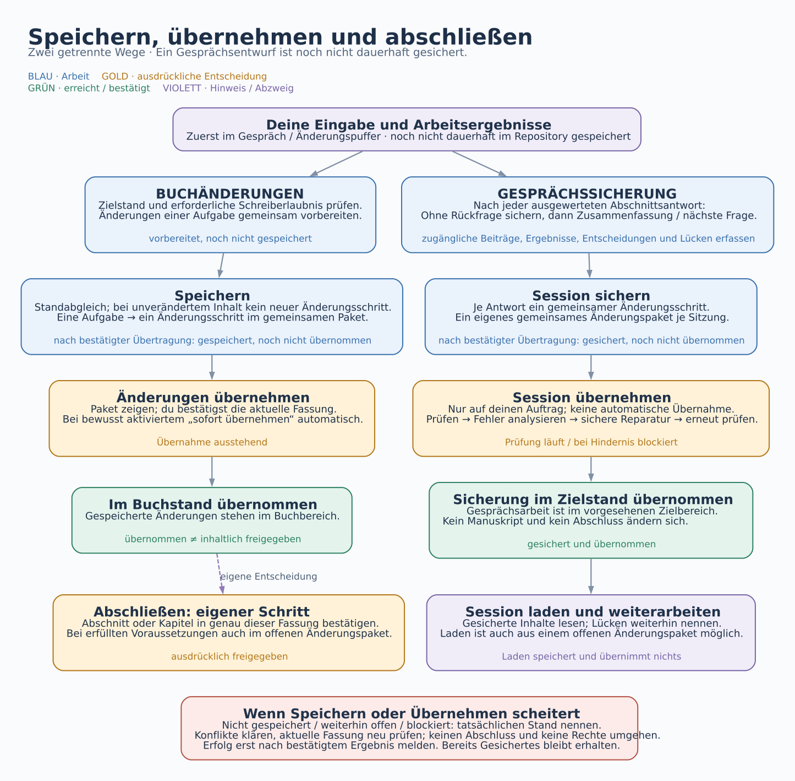

# Speichern, Übernehmen und Abschließen

Deutsch · [English](SAVING.en.md)

[Anleitung](ANLEITUNG.md) · [Buchablauf](BUCHABLAUF.md) · [Erstellungskreislauf](ERSTELLUNGSKREISLAUF.md) · **Speichern und Übernehmen**

Ein Ergebnis im Chat ist noch nicht dauerhaft im Repository gesichert. Beim Speichern gibt es zwei Wege: Buchänderungen ändern den Arbeitsstand des Buchs; eine Gesprächssicherung bewahrt das Gespräch und seine Ergebnisse getrennt vom Manuskript. Beide Wege unterscheiden **gespeichert**, **übernommen** und **inhaltlich freigegeben**.

[Grafik als skalierbares SVG öffnen](bilder/ablaeufe/speichern-de.svg)

## Buchänderungen speichern und übernehmen

Der Assistent prüft den aktuellen Buchstand und ob das Schreiben erlaubt ist, sammelt alle zusammengehörigen Änderungen einer Aufgabe und prüft sie gemeinsam. Erst danach werden sie als ein Änderungsschritt im gemeinsamen Änderungspaket gespeichert. Unveränderte Inhalte erzeugen keinen neuen Änderungsschritt.

Auch geänderte Startanweisungen und Skills verlangen einen erneuten Abgleich vor dem Schreiben. Der lokale Helfer `workflow_support.py … guard` erkennt Änderungen und Löschungen an `START.md`, `CLAUDE.md`, `AGENTS.md`, unter `docs/start/` und unter `.claude/skills/` einschließlich persönlicher Skills als Kontextänderung. Er prüft nur die bereitgestellten Git-Stände; aktuelle Remote-Daten und eine atomare Prüfung beim anschließenden Speichern bleiben erforderlich.

Der lokale Snapshot von `standabgleich.py` enthält zusätzlich einen Fingerabdruck von `scripts/`, `schemas/`, `integrations/`, `templates/`, `assets/`, `.github/workflows/`, `workflow.yml`, `providers.yml` und `ghostwriter-manifest.yml` im geprüften Programmstand. Änderungen daran verlangen auch bei gleicher Versionsnummer und gleichem eingetragenem Upstream-Commit einen erneuten Abgleich. Ältere Snapshots ohne diesen Fingerabdruck bleiben lesbar, verlangen aber vor dem Schreiben einen neuen Snapshot. Ungespeicherte lokale Änderungen und die automatische Aktualisierung von Remote-Refs sind davon nicht erfasst.

War im Snapshot kein Arbeitsbranch ausgewählt, beobachtet der Vergleich zusätzlich den laut Manifest erwarteten Branchnamen. Ein neu erschienener oder geänderter Kandidat mit anderem Head als das Buch verlangt vor dem Schreiben eine Prüfung der Zuordnung und des offenen Pull Requests. Er wird nicht automatisch zur Lesebasis. Ein bereits erfasster ungewählter Kandidat oder ein zum Buch identischer Branch löst diesen Hinweis nicht aus; Arbeitsbranches anderer Bücher bleiben unbeteiligt.

Ist der ausgewählte Arbeitsstand vollständig in der Buchhistorie enthalten, prüft der Vergleich Datenversion und Index am aktuellen Buchstand, auch solange der Arbeitsbranch noch existiert. Er meldet die Übernahme und verlangt erneutes Lesen vom Buchbranch. Zusätzliche noch nicht übernommene Arbeitscommits bleiben ausgewählt; ein zurückgesetzter oder abweichender Arbeitsbranch gilt nicht als übernommener Stand. Die lesende Prüfung löscht keine Branches und erteilt keine inhaltliche Freigabe.

Nach bestätigter Übertragung lautet der Stand **gespeichert, noch nicht übernommen**. Du kannst diesen Arbeitsstand bereits ansehen und weiterbearbeiten; die Ansichten lesen aus dem offenen Änderungspaket. Im übernommenen Buchstand stehen die Änderungen erst nach **Änderungen übernehmen**. Dabei bestätigst du die gezeigte aktuelle Fassung. Kommt inzwischen etwas dazu, muss die geänderte Fassung erneut gezeigt werden.

Wenn du für dein Buch **sofort übernehmen** (`changes.auto_merge: true`) bewusst aktiviert hast, werden gewöhnliche Buchänderungen nach dem Speichern automatisch übernommen. Inhaltliche Freigaben bleiben eigene ausdrückliche Entscheidungen. Eine Auflage hat immer ihr eigenes Änderungspaket und braucht eine ausdrückliche Übernahmebestätigung.

## Gesprächsarbeit sichern und wieder aufnehmen

**Session sichern** hält tatsächlich zugängliche Gesprächsbeiträge, Recherche, Brainstorming samt Varianten, Entscheidungen, Entwürfe, Planung und offene Punkte fest. Eine Kurzfassung ersetzt die eigentlichen Inhalte nicht. Beim manuellen Sichern erhält jedes geänderte Themengebiet einen Änderungsschritt; automatische Antwortstände bündeln alle Themen in einem Commit. Je Sitzung gibt es ein gemeinsames Änderungspaket.

Nach jeder ausgewerteten Abschnittsantwort wird ohne weitere Rückfrage ein kleiner Session-Nachtrag mit der neuen Frage, Originalantwort, Ergebnis und offenen Punkten hochgeladen und geprüft. Erst danach erscheinen Zusammenfassung und nächste Frage. Offene Fragen verhindern die Sicherung nicht. „Session sichern“ und der Dialogabschluss sichern weiterhin den vollständigen verfügbaren Stand. Der Abschnittsdialog erhält zusätzlich einen Abschlussnachweis, sobald alle besprochenen Punkte geklärt oder vertagt sind. Das ist keine Abschnittsfreigabe. Ohne ausführenden Assistenten und Schreibzugriff gibt es keine unabhängige Hintergrundsicherung.

Nach bestätigter Übertragung ist die Sitzung **gesichert, noch nicht übernommen**. **Session übernehmen** beauftragt Prüfung, Fehleranalyse, einen sicheren technischen Reparaturversuch und erneute Prüfung. Nur bei Erfolg wird das Paket übernommen. „Sofort übernehmen“ gilt für Gesprächssicherungen nicht. Manuskript und inhaltliche Freigaben bleiben bei diesem Vorgang unverändert.

**Session laden** liest gesicherte Inhalte zum Weiterarbeiten, auch aus einem noch offenen Änderungspaket. Laden speichert nichts und übernimmt nichts. Fehlende Beiträge oder Anhänge bleiben sichtbar. Befehle, Ablage, Vertraulichkeit und technische Grenzen stehen in [Session sichern und übernehmen](SESSION-SICHERUNG.md).

## Die Zustände auseinanderhalten

Die folgenden Begriffe beschreiben den Speicherstand; sie sind keine zusätzlichen Abschnitts- oder Kapitelzustände. Kurz erklärt stehen sie auch im [Bedienglossar](BEDIENGLOSSAR.md#speichern-und-übernehmen).

| Zustand | Was er bedeutet |
|---|---|
| Vorbereitet | Im Chat oder lokalen Änderungspuffer; noch nicht dauerhaft im Repository gesichert. |
| Gespeichert / gesichert, noch nicht übernommen | Die Übertragung ist bestätigt; das Änderungspaket ist noch offen. |
| Prüfung läuft | Voraussetzungen, Inhalt und aktueller Stand werden geprüft; eine Übernahme ist noch nicht bestätigt. |
| Übernommen | Das Paket ist nach bestätigter Übernahme im vorgesehenen Zielstand. |
| Abgeschlossen | Eine gesonderte ausdrückliche Entscheidung bestätigt die konkrete Textfassung; der Text ist danach gesperrt (früher „inhaltlich freigegeben“). |
| Nicht gespeichert / weiterhin offen / blockiert | Ein Vorgang ist fehlgeschlagen oder wartet auf Klärung; der tatsächliche erhaltene Stand muss genannt werden. |

## Abschließen ist eine eigene Entscheidung

**Schreiben erlauben** gibt den Abschnitt zum Schreiben frei; **Abschnitt abschließen** bestätigt die genaue Textfassung und sperrt sie; **Kapitel abschließen** bestätigt das zusammengeführte Kapitel. Rückgängig macht man beides mit **wieder öffnen**. Keine dieser Bestätigungen (technisch „Freigaben“, #292) entsteht allein durch Speichern, eine erfolgreiche technische Prüfung oder Übernehmen. Eine zulässige inhaltliche Freigabe kann auch im noch offenen Änderungspaket protokolliert werden; die Grafik verlangt keine vorherige Übernahme.

## Hinweise durchsehen

In der Hinweisdurchsicht (#367, [Lektorat](LEKTORAT.md#hinweise-durchsehen-hinweisdurchsicht-367)) wird jede Antwort ohne weitere Rückfrage als kleiner Nachtrag im offenen Änderungspaket gespeichert, wie ein Session-Nachtrag. Dabei ändert sich nur die Dialogdatei `editorial/durchsicht-<datum>.yml`, nicht das Manuskript. Das Umsetzen (`hinweise.py apply`) ist eine gewöhnliche Buchänderung mit eigenem Änderungsschritt; abgeschlossene Abschnitte oder Kapitel müssen vorher ausdrücklich wieder geöffnet werden. Übernommen wird wie bei anderen Buchänderungen; mit „sofort übernehmen“ oder „übernehmen, wenn grün“ erst nach erfolgreichen Repository-Prüfungen.

## Wenn etwas fehlschlägt

Bei zwischenzeitlich geänderten betroffenen Dateien wird vor dem Schreiben neu abgeglichen. Konflikte, fehlende Rechte und unklare Entscheidungen dürfen nicht umgangen werden. Vor einem erneuten Übernahmeversuch wird geprüft, ob der erste Versuch trotz Verbindungsfehler bereits erfolgreich war.

Eine Erfolgsmeldung setzt ein bestätigtes Ergebnis voraus. Ist die Übertragung erfolgreich, die Übernahme aber nicht, bleiben die Inhalte **gespeichert und offen**. Ist die Übertragung nicht bestätigt, darf der neue Stand nicht als dauerhaft gesichert bezeichnet werden. Vorhandene Sicherungen bleiben erhalten; der Assistent nennt den konkreten Blocker und den nächsten nötigen Schritt.

## Persönliches Freigaberecht und Inhaltsnachweis

Ein Name in `approvals.yml` ist kein Identitätsnachweis. Vor neuen Freigaben prüft `python scripts/approval_authority.py BUCH actor` das persönlich angemeldete GitHub-Konto. Eigentümer dürfen freigeben; bei Organisationen muss eine aktive Eigentümerrolle über GitHub nachweisbar sein. Bearbeiter mit bloßem Schreibrecht dürfen ohne gesonderte Bevollmächtigung nicht freigeben. Bei fehlendem Zugriff wird die Freigabe gesperrt. Automatisierte GitHub-Actions-Jobs dürfen auch mit einem hinterlegten Benutzer-Token keine neuen persönlichen Freigaben erteilen; vorhandene persönliche Nachweise dürfen sie für die Veröffentlichung prüfen.

Für eine veröffentlichbare Ausgabe kommt ein persönlicher **Inhaltsnachweis** hinzu. Er bestätigt den konkreten Buchstand und die gewählte Auflage; Probedruck, Vorabfassung und Arbeits-/Lesefassungen bleiben ohne diesen Nachweis möglich. Auch die technischen Abschlusszustände, Grundregeln, Bilder, Quellen, Umschlag und tatsächlich verwendeten Seriendaten sind gebunden. Eine Änderung dieser Daten erfordert einen neuen Nachweis. Der Nachweis wird vor dem Bau, nach dem Bau und vor der Veröffentlichung geprüft; fehlender API-Zugang oder eine inzwischen zurückgenommene Berechtigung sperren die Veröffentlichung.

1. Freigaben wie bisher ausdrücklich bestätigen und protokollieren; `by` bei neuen Einträgen aus dem verifizierten Konto übernehmen. Vorhandene historische Namen bleiben unverändert und werden dadurch nicht nachträglich authentifiziert.
2. Den vorgesehenen Buchstand zuerst als Commit im Arbeitsbranch speichern, dann dort `python scripts/approval_authority.py BUCH prepare --edition 1` ausführen. Die Ausgabe enthält nur Repositorykennung, Buchbranch, Auflage, Zweck und einen Inhaltsfingerabdruck, keine Buchtexte.
   Ohne lokale Laufzeit die manuelle GitHub-Action **Persönlichen Inhaltsnachweis vorbereiten oder prüfen** (`approval.yml`) auf genau diesem Arbeitsbranch starten, mit `action: prepare`, `edition` und optional `omnibus`. Das Artefakt `persoenlicher-inhaltsnachweis` enthält denselben JSON-Text. Die Action liest nur; sie erteilt keine Freigabe und schreibt keine Buchdateien.
3. Der Eigentümer oder ausdrücklich Bevollmächtigte gibt **diesen vollständigen JSON-Text nach eigener Prüfung als GitHub-PR-Review** ab. Dafür ist ein eingereichter `COMMENT`-Review möglich, auch bei eigenen Änderungen; ein normales „LGTM“ genügt nicht. Nicht automatisch im Namen des Benutzers abgeben. Kein Entwurfsreview (`PENDING`), kein Bot und kein zurückgenommener oder nachträglich bearbeiteter Review. Statt einen Nachweis zu bearbeiten einen neuen Review abgeben.
4. Den bereits abgegebenen Review mit `python scripts/approval_authority.py BUCH attach --edition 1 --pull-request 12 --review-id 34` prüfen und zuordnen. Der tatsächlich besprochene Review-Commit muss lokal vorhanden sein und dieselben Buchdaten enthalten; falls nötig zuerst den PR-Ausgangsstand abrufen. Erst eine erfolgreiche Prüfung ergänzt `authority` in `approvals.yml`; der Befehl erzeugt weder Commit noch Upload. Danach gelten die normalen Speicher-/Übernahmeregeln. Ohne lokale Laufzeit die Reviewkennungen mit den vorhandenen Dateiwerkzeugen zunächst als ungeprüften Nachweis speichern und dieselbe lesende Action auf genau diesem gespeicherten Branch mit `action: check` ausführen. Erst deren erfolgreicher Abschluss bestätigt den Nachweis; Speichern allein genügt nicht.
5. `python scripts/approval_authority.py BUCH check --edition 1` kontrolliert den aktuellen Nachweis. `python scripts/validate_project.py BUCH --verify-authority` ergänzt die sonst rein strukturelle Projektprüfung um die persönliche Inhaltsprüfung. Auflagenbauer und veröffentlichbare Buch-/Kapitelzusammenstellung verlangen den Nachweis auch ohne dieses optionale Validatorargument.

Für Sammelbände bei `prepare`, `attach` und `check` zusätzlich `--omnibus ser-kennung` verwenden. Der Nachweis ist an diesen Verwendungszweck gebunden und kann nicht als normale Buchfreigabe wiederverwendet werden. Die veröffentlichten Bandstände werden über die lokalen Auflagen-Tags mitgebunden; neue oder geänderte Tags erfordern einen neuen Nachweis. Der Sammelband-Prüflauf verlangt ebenfalls einen persönlichen Nachweis.

**Zusätzliche Freigabeberechtigte:** `python scripts/approval_authority.py BUCH delegate --delegate-login NAME` erzeugt ausschließlich den Text einer Bevollmächtigung. Nur ein gültiger, persönlich zuordenbarer Eigentümer-Review mit genau diesem Text erteilt sie für diesen Buchbranch in diesem Repository; sie gilt nicht für ein anderes Buch. Ein Nachweis eines Bevollmächtigten erhält bei `attach` zusätzlich `--delegation-pull-request 12 --delegation-review-id 35`. Weiterdelegieren ist nicht erlaubt. Wird der Eigentümer-Review zurückgenommen oder sein Text geändert, verliert die Bevollmächtigung ihre Gültigkeit. Repository-Schreibrecht, `by`, Commit-Autor und frei editierte Namenslisten ersetzen diesen Nachweis nicht.

**Vorhandene Bücher:** Alte Einträge werden nicht automatisch umgeschrieben. Vor der nächsten veröffentlichbaren Ausgabe muss ein Berechtigter den aktuellen Inhalt mit einem neuen Nachweis ausdrücklich bestätigen; dies bestätigt den heutigen Stand, nicht die historische Identität jedes alten Eintrags. Ohne Zugang kann weiter am Entwurf gearbeitet und ein Probedruck erzeugt werden. Organisationsrechte, tatsächliche Reviews und die Abläufe in den einzelnen Clients sind praktisch zusätzlich abzunehmen.

GitHub bleibt der bestehende Speicher und Identitätsanbieter; es gibt keinen neuen GhostWriter-Verwaltungsdienst. Die Überprüfung nutzt ausschließlich die lesenden [Review-Endpunkte von GitHub](https://docs.github.com/en/rest/pulls/reviews), prüft zusätzlich Originalreview-Metadaten über eine lesende [GitHub-GraphQL-Abfrage](https://docs.github.com/en/graphql/reference/pulls) und gegebenenfalls die [Organisationsmitgliedschaft](https://docs.github.com/en/rest/orgs/members). Persönliche Konten sind erforderlich; geteilte Zugangsdaten lassen sich damit nicht einzelnen Menschen zuordnen. Wer Programmdateien oder GitHub-Veröffentlichungen außerhalb von GhostWriter direkt ändern darf, kann diese lokalen Prüfungen umgehen; daraus wird keine zusätzliche GitHub-Zugriffsschranke behauptet.

---

Entwickelt mit Unterstützung von Claude (Anthropic) · <a href="https://claude.ai">claude.ai</a> Entwickelt mit Unterstützung von Codex (OpenAI)&nbsp;&nbsp;<picture><source media="(prefers-color-scheme: dark)" srcset="../assets/logo-dark.svg"></picture>

