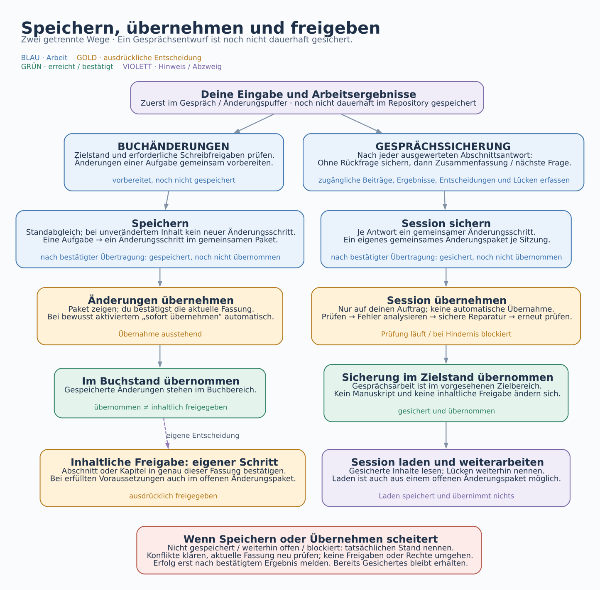

# Speichern, Übernehmen und Freigeben

Deutsch · [English](SAVING.en.md)

[Anleitung](ANLEITUNG.md) · [Buchablauf](BUCHABLAUF.md) · [Erstellungskreislauf](ERSTELLUNGSKREISLAUF.md) · **Speichern und Übernehmen**

Ein Ergebnis im Chat ist noch nicht dauerhaft im Repository gesichert. Beim Speichern gibt es zwei Wege: Buchänderungen ändern den Arbeitsstand des Buchs; eine Gesprächssicherung bewahrt das Gespräch und seine Ergebnisse getrennt vom Manuskript. Beide Wege unterscheiden **gespeichert**, **übernommen** und **inhaltlich freigegeben**.

[Grafik als skalierbares SVG öffnen](bilder/ablaeufe/speichern-de.svg)

## Buchänderungen speichern und übernehmen

Der Assistent prüft den aktuellen Buchstand und die erforderlichen Freigaben, sammelt alle zusammengehörigen Änderungen einer Aufgabe und prüft sie gemeinsam. Erst danach werden sie als ein Änderungsschritt im gemeinsamen Änderungspaket gespeichert. Unveränderte Inhalte erzeugen keinen neuen Änderungsschritt.

Nach bestätigter Übertragung lautet der Stand **gespeichert, noch nicht übernommen**. Du kannst diesen Arbeitsstand bereits ansehen und weiterbearbeiten; die Ansichten lesen aus dem offenen Änderungspaket. Im übernommenen Buchstand stehen die Änderungen erst nach **Änderungen übernehmen**. Dabei bestätigst du die gezeigte aktuelle Fassung. Kommt inzwischen etwas dazu, muss die geänderte Fassung erneut gezeigt werden.

Wenn du für dein Buch **sofort übernehmen** (`changes.auto_merge: true`) bewusst aktiviert hast, werden gewöhnliche Buchänderungen nach dem Speichern automatisch übernommen. Inhaltliche Freigaben bleiben eigene ausdrückliche Entscheidungen. Eine Auflage hat immer ihr eigenes Änderungspaket und braucht eine ausdrückliche Übernahmebestätigung.

## Gesprächsarbeit sichern und wieder aufnehmen

**Session sichern** hält tatsächlich zugängliche Gesprächsbeiträge, Recherche, Brainstorming samt Varianten, Entscheidungen, Entwürfe, Planung und offene Punkte fest. Eine Kurzfassung ersetzt die eigentlichen Inhalte nicht. Beim manuellen Sichern erhält jedes geänderte Themengebiet einen Änderungsschritt; automatische Antwortstände bündeln alle Themen in einem Commit. Je Sitzung gibt es ein gemeinsames Änderungspaket.

Nach jeder ausgewerteten Abschnittsantwort wird ohne weitere Rückfrage ein gemeinsamer Commit mit Gespräch, Auswertung und Fragenstand hochgeladen und geprüft. Erst danach erscheinen Zusammenfassung und nächste Frage. Offene Fragen verhindern die Sicherung nicht. Der Abschnittsdialog erhält zusätzlich einen Abschlussnachweis, sobald alle besprochenen Punkte geklärt oder vertagt sind. Das ist keine Abschnittsfreigabe. Ohne ausführenden Assistenten und Schreibzugriff gibt es keine unabhängige Hintergrundsicherung.

Nach bestätigter Übertragung ist die Sitzung **gesichert, noch nicht übernommen**. **Session übernehmen** beauftragt Prüfung, Fehleranalyse, einen sicheren technischen Reparaturversuch und erneute Prüfung. Nur bei Erfolg wird das Paket übernommen. „Sofort übernehmen“ gilt für Gesprächssicherungen nicht. Manuskript und inhaltliche Freigaben bleiben bei diesem Vorgang unverändert.

**Session laden** liest gesicherte Inhalte zum Weiterarbeiten, auch aus einem noch offenen Änderungspaket. Laden speichert nichts und übernimmt nichts. Fehlende Beiträge oder Anhänge bleiben sichtbar. Befehle, Ablage, Vertraulichkeit und technische Grenzen stehen in [Session sichern und übernehmen](SESSION-SICHERUNG.md).

## Die Zustände auseinanderhalten

Die folgenden Begriffe beschreiben den Speicherstand; sie sind keine zusätzlichen Abschnitts- oder Kapitelzustände.

| Zustand | Was er bedeutet |
|---|---|
| Vorbereitet | Im Chat oder lokalen Änderungspuffer; noch nicht dauerhaft im Repository gesichert. |
| Gespeichert / gesichert, noch nicht übernommen | Die Übertragung ist bestätigt; das Änderungspaket ist noch offen. |
| Prüfung läuft | Voraussetzungen, Inhalt und aktueller Stand werden geprüft; eine Übernahme ist noch nicht bestätigt. |
| Übernommen | Das Paket ist nach bestätigter Übernahme im vorgesehenen Zielstand. |
| Inhaltlich freigegeben | Eine gesonderte ausdrückliche Entscheidung bestätigt die konkrete Textfassung. |
| Nicht gespeichert / weiterhin offen / blockiert | Ein Vorgang ist fehlgeschlagen oder wartet auf Klärung; der tatsächliche erhaltene Stand muss genannt werden. |

## Freigabe ist eine eigene Entscheidung

**Schreibfreigabe** erlaubt das Schreiben; **Abschnittsfreigabe** bestätigt die genaue Textfassung; **Kapitelfreigabe** bestätigt das zusammengeführte Kapitel. Keine dieser Freigaben entsteht allein durch Speichern, eine erfolgreiche technische Prüfung oder Übernehmen. Eine zulässige inhaltliche Freigabe kann auch im noch offenen Änderungspaket protokolliert werden; die Grafik verlangt keine vorherige Übernahme.

## Wenn etwas fehlschlägt

Bei zwischenzeitlich geänderten betroffenen Dateien wird vor dem Schreiben neu abgeglichen. Konflikte, fehlende Rechte und unklare Entscheidungen dürfen nicht umgangen werden. Vor einem erneuten Übernahmeversuch wird geprüft, ob der erste Versuch trotz Verbindungsfehler bereits erfolgreich war.

Eine Erfolgsmeldung setzt ein bestätigtes Ergebnis voraus. Ist die Übertragung erfolgreich, die Übernahme aber nicht, bleiben die Inhalte **gespeichert und offen**. Ist die Übertragung nicht bestätigt, darf der neue Stand nicht als dauerhaft gesichert bezeichnet werden. Vorhandene Sicherungen bleiben erhalten; der Assistent nennt den konkreten Blocker und den nächsten nötigen Schritt.

---

Entwickelt mit Unterstützung von Claude (Anthropic) · <a href="https://claude.ai">claude.ai</a> Entwickelt mit Unterstützung von Codex (OpenAI)&nbsp;&nbsp;<picture><source media="(prefers-color-scheme: dark)" srcset="../assets/logo-dark.svg"></picture>

